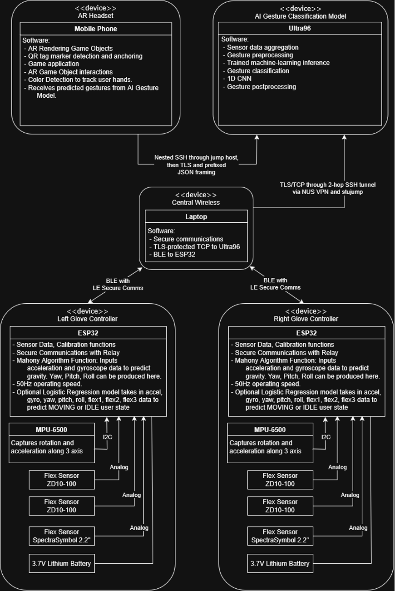

# Let Them Cook

An augmented-reality cooking game inspired by Overcooked, built for NUS CG4002 (Computer Engineering Capstone), Group B07.

The player wears a phone in a headset and a gesture glove on each hand. The phone shows a virtual kitchen pinned to QR codes on a real table. The gloves sense **what** each hand is doing (chop, pour, grab, throw...). An AI model on the Ultra96 FPGA board classifies each glove's motion, and the phone's camera and LiDAR find **where** each hand is. The game combines the two so both hands can cook at the same time.

## System overview



1. **Hardware:** each glove samples its IMU and flex sensors and streams them over Bluetooth Low Energy.
2. **Comms:** the laptop relays both gloves' streams to the Ultra96 over TLS. The Ultra96 service passes each sample to the AI model and publishes the results.
3. **AI:** a 1D CNN, accelerated on the Ultra96's FPGA, turns each 50 × 12 window of one glove's sensor data into a gesture label with a confidence.
4. **Visualiser:** the phone app subscribes to the results (through the NUS VPN), maps each label to a game action for the left or right hand, and runs the game.

## Repository map

| Subcomponent | Folders | Start here |
|---|---|---|
| **Hardware** (gloves) | `hardware/gloves/` | [hardware/gloves/README.md](hardware/gloves/README.md) |
| **Comms** (firmware transport, laptop relay, Ultra96 service, phone package) | `firmware/esp32/`, `common/`, `laptop/`, `ultra96/`, `phone/`, `ios-visualizer/`, comms scripts in `tools/` | [Communications](#communications) below, [ios-visualizer/README.md](ios-visualizer/README.md) |
| **AI** (data, training, evaluation, FPGA) | `src/`, `models/`, `data/`, `reports/`, `fpga/`, `docs/`, AI scripts in `tools/` | [docs/ai/README_AI_20261019.md](docs/ai/README_AI_20261019.md), [docs/AI_LAB_START_HERE.md](docs/AI_LAB_START_HERE.md), [fpga/README_FPGA_PYNQ.md](fpga/README_FPGA_PYNQ.md), [docs/ai/README_FULL_CNN.md](docs/ai/README_FULL_CNN.md) |
| **Visualiser** (Unity AR game) | `vis/` | [vis/README.md](vis/README.md) |

**Shared folders:** `tools/` and `tests/` hold scripts and tests from both comms and AI (comms: `demo*`, `flash`, `check_board`, `deploy_service`, `ssh_tunnel`, `live_*`, `rehearse_*`...; AI: `hand_*`, `precision_*`, `export_fpga_reference`...). `common/` holds the wire format and sensor contracts that comms and AI both use.

```
Let-Them-Cook/
├── hardware/gloves/      Hardware: glove sketches, sensor module, schematic, recorders
├── firmware/esp32/       Comms: glove firmware (BLE transport, packets, security); links the hardware sensor module
├── common/               Comms + AI: wire format, sensor packet versions, hand contract, TLS
├── laptop/               Comms: Windows BLE relay to the Ultra96
├── ultra96/              Comms: Ultra96 TLS service, protocol, model bridge
├── phone/                Comms: earlier phone receiver (Python / Android)
├── ios-visualizer/       Comms: CommsNative Swift package linked into the iOS game build
├── src/                  AI: preprocessing, training, evaluation, inference, Ultra96 worker
├── models/               AI: trained models
├── data/                 AI: datasets
├── reports/              AI: evaluation and FPGA build reports
├── fpga/                 AI: HLS source, Vivado project, PYNQ bitstreams and overlays
├── docs/                 AI: guides and experiment notes (docs/ai/ for the main guides)
├── tools/                Comms + AI: command-line scripts
├── tests/                Comms + AI: automated tests
└── vis/                  Visualiser: Unity project (Assets, Packages, ProjectSettings)
```

## Running the full system

The final build uses **sensor version 5** (the format of the hand12 v5 models). The gloves, the Ultra96 service and the laptop must all use the same version, or the laptop and service refuse the samples. The tools default to version 3 when no version is given, so always pass the version 5 options below.

1. **Gloves:** flash and pair both boards with `python -m tools.flash --glove --wide-gyro --gyro-dps 2000` (`--wide-gyro` builds version 5 and implies `--flex3`; `--gyro-dps 2000` sets the ±2000 deg/s gyro range the final model (candidate3) was trained on, and only works together with `--glove --wide-gyro`. Without it the gloves run at ±1000 deg/s, which the service still accepts but recognition gets worse). See [hardware/gloves/README.md](hardware/gloves/README.md) for the hardware.
2. **Ultra96:** connect to the NUS VPN, then deploy the service and the AI worker with `python -m tools.deploy_service --sensor-version 5 --model ultra96.model_bridge --runner-module src.socket_worker_hand --runner-cwd <board checkout> ...`, adding the runner arguments from the AI guide ([docs/ai/README_AI_20261019.md](docs/ai/README_AI_20261019.md), [docs/ai/README_FULL_CNN.md](docs/ai/README_FULL_CNN.md)). This is the example in the docstring of [tools/deploy_service.py](tools/deploy_service.py). Add `--dry-run` first to print the plan.
3. **Laptop relay:** start the SSH tunnel and both glove streams with `python -m tools.demo start --sensor-version 5`.
4. **Phone:** build the Unity project with CommsNative ([vis/README.md](vis/README.md#building)), open the app, tap **Communications Connect**, wait for **Subscribed**, then scan the QR codes to place the kitchen. The game reads per-hand events (`COMMS_HAND_EVENTS` is already set in the Unity project settings).

## Requirements

| For | File / tool |
|---|---|
| Comms (laptop) | `pip install -r tools/requirements-dev.txt` (root `requirements-dev.txt` kept for compatibility) |
| AI (training) | `requirements.txt`, `requirements_training.txt`, `requirements_hand_ai.txt` |
| AI (Ultra96 board) | `requirements_board.txt` |
| Glove firmware | PlatformIO (`firmware/esp32/platformio.ini`) |
| Visualiser | Unity 6 (6000.5) with iOS support, Xcode, iPhone with LiDAR (iOS 15+) |

## AI gesture model

- **Input:** a 50 × 12 sensor window from one glove.
- **Output:** one of seven classes: `PICKUP`, `DROP`, `CHOP`, `WASH`, `THROW`, `POURING` and `IDLE`.
- **Two hands:** the left and right gloves use independent model parameters while sharing one CNN accelerator on the FPGA.
- **Final model bundle:** [models/hand12_v5_candidate3/](models/hand12_v5_candidate3/).
- **Training data:** the prepared training dataset is not in this repository; it was sent separately as `Final_Prepared_Hand_Dataset.zip`.

## Communications

Protected sensor streams from the two FireBeetle32 glove boards go over BLE to a Windows relay, then over TLS-protected TCP (through an SSH tunnel) to the Ultra96 service. The service passes each new sample to the AI worker: `ultra96.model_bridge` hands samples to `src.socket_worker_hand`, which connects to the service over a Unix socket. (With no model configured, the service falls back to a built-in dummy model.) The service sends the results to an iPhone app that links this repository's `CommsNative` package.

- [tools/flash.py](tools/flash.py): build, upload and pair the LEFT and RIGHT boards; run `python -m tools.flash --help` for options.
- [tools/demo.py](tools/demo.py): run a whole capture in one command (`python -m tools.demo start`: the SSH tunnel, both boards, a live view and one `run.log`; `q` stops it), or open the SSH tunnel, capture both streams and review reports step by step; run `python -m tools.demo --help`, `python -m tools.demo start --help` or `python -m tools.demo run --help` for options.
- [tools/check_board.py](tools/check_board.py): check one flashed board against a service on this laptop, with no SSH, Ultra96 or phone; run `python -m tools.check_board left` or `right`.
- [tools/deploy_service.py](tools/deploy_service.py): deploy this source's board service, and optionally a renewed server certificate, to the project's Ultra96 in one step, with rollback; run `python -m tools.deploy_service --dry-run` first. It needs `paramiko` from [tools/requirements-dev.txt](tools/requirements-dev.txt).
- [iOS source and integration boundary](ios-visualizer/README.md) · [native build and preview](ios-visualizer/NATIVE-INTEGRATION.md).

Run these commands from the repository root. Install Communications dependencies with `python -m pip install -r tools/requirements-dev.txt`. The root `demo.py`, `flash.py` and `requirements-dev.txt` remain compatibility entry points, so existing commands still work.

**Sensor format:** the final build uses sensor version 5 (40-byte packets with 12 values, source statistics `LCS5`). Version 3 (`LCS3`) is only what the tools use when no version is given. Sensor packets use the `LC` marker, and the session is `ltc-comms`. Laptop, server and phone must use the same session; `--session-id` changes it for the laptop commands. The TLS name `ultra96.week7.internal` is written into the server certificate, so it stays.

**Hand events:** the phone subscribes with `SUBSCRIBE` version 2 and receives `HAND_EVENT` frames as well as `GESTURE_RESULT`. Unity reads them with `CommsNextHandEvent` and `CommsHandState` when built with `COMMS_HAND_EVENTS`.

The Unity Xcode export and a prebuilt iPhone app are not part of this repository.

## Team

| Subcomponent | Owner |
|---|---|
| Hardware | Zhong Siqiang |
| Comms | Wang Yanjie |
| AI | Ooi Wen Ree |
| Visualiser | Goh Jie Ling |
